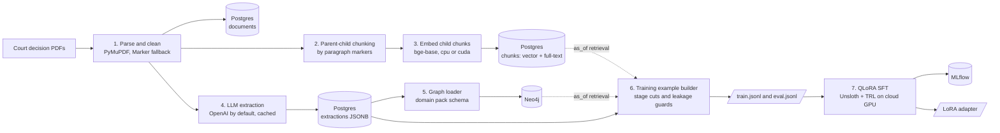
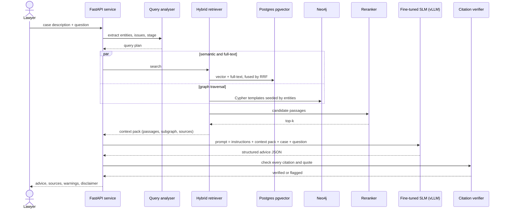
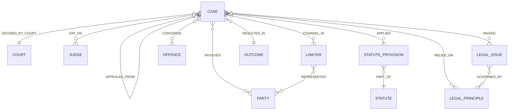
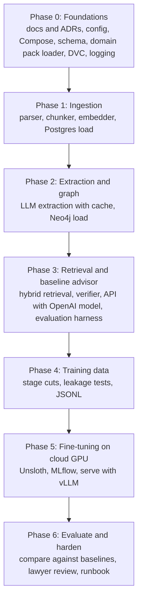
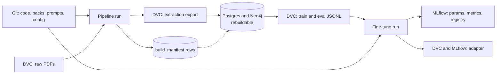
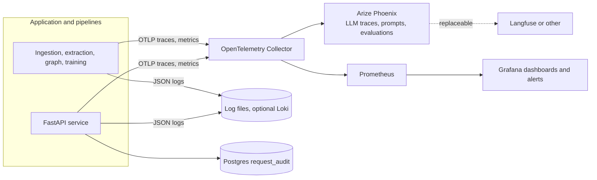

# INSTRUCTIONS: CLES (Cognitive Legal Expert System)

Approach: dual-database retrieval (pgvector + Neo4j GraphRAG) plus a fine-tuned small language model (SLM).
This file is the single source of truth for the build. Agent behaviour rules are in [AGENTS.md](AGENTS.md).

---

## 1. Product definition

CLES is an advisory copilot for lawyers. The lawyer describes a case as it stands today (at the very beginning or at an advanced stage) and asks a question. CLES answers with:

- where the case stands
- the possible routes, each with its expected outcome and rough likelihood
- the risks
- recommended next steps
- the supporting authorities (cases, statutes, principles), each with a verified citation

CLES learns from a corpus of about 10,000 court decisions (first corpus: Ontario Court of Appeal, `ONCA`). The deliverable is **software**, not data. The user will later run the finished pipeline on the real corpus on rented GPU hardware.

### How it works

1. The question goes to the retrieval engine, which queries both stores: pgvector (similar passages) and Neo4j (multi-hop structure).
2. The retrieved material is injected into the prompt with the question.
3. A fine-tuned SLM writes the advice. Fine-tuning teaches it how to reason, what to focus on, and the output format. It is **not** trusted as a source of facts.
4. A verifier checks every citation against the database before the answer is shown.

### Core principles

| # | Principle | Consequence |
|---|-----------|-------------|
| P1 | Law needs exactness; fluent text proves nothing | Facts come from retrieval, never from the model's memory. Every claim is cited and checked (section 10). |
| P2 | The domain must be swappable | Legal specifics live only in a **domain pack** (section 5). Generic code never mentions judges or statutes. |
| P3 | No leakage | A case's own outcome never appears in its own training input, retrieval, or evaluation (section 9). |
| P4 | Readable, maintainable code | Small modules, type hints, docstrings, plain functions, tests (section 12). |
| P5 | Everything is configurable and resumable | Providers, models, devices and paths come from config. Every long job can resume and has a dry-run mode. |
| P6 | Paid calls are controlled | Cache every LLM extraction, support batch mode, estimate cost before running. |
| P7 | Everything is reproducible | Any store or model can be traced to a code commit, a data version, a domain-pack version and a config (section 17). |
| P8 | Everything is observable | Pipelines and requests emit logs, metrics and traces, and answer quality is measured continuously (section 18). |
| P9 | Client information is confidential | Lawyers' case descriptions stay on infrastructure we control; telemetry redacts them by default (sections 10 and 18). |
| P10 | Every significant decision is explained | Each architectural decision gets a short ADR in `docs/adr/` (context, options, decision, consequences), because the owner is an architect who must be able to defend and change the design. |

---

## 2. Architecture

### 2.1 Offline pipeline (build time)



Note: the graph and the chunks feed **retrieval**. Only the JSONL feeds fine-tuning. Retrieval is used while building training examples (RAFT style), so the SLM learns to use retrieved context.

### 2.2 Runtime flow (query time)



### 2.3 Component summary

| Component | Responsibility | Technology |
|-----------|----------------|------------|
| Parser | PDF to clean text and paragraph-structured sections | PyMuPDF (default), Marker (scans, optional), LlamaParse (optional, sends data to a third party) |
| Chunker | Parent chunks (sections) and child chunks (embedding units, at most 400 tokens) | Python, tokenizer of the embedding model |
| Embedder | Child chunk vectors, 768 dimensions | `BAAI/bge-base-en-v1.5`, device `auto/cpu/cuda` from config |
| Vector and text store | Chunks, vectors, full-text, extraction cache | PostgreSQL 16 + pgvector (HNSW, cosine) + `tsvector` GIN |
| Graph store | Entities and relations, multi-hop traversal | Neo4j 5.x (pinned, current LTS at implementation time) |
| Extraction LLM | Metadata, entities, citations with treatment, stage cuts | OpenAI by default behind a provider interface (configurable base URL and model) |
| Retriever | Vector + full-text (RRF), graph traversal, rerank, `as_of` date filter | Python, cross-encoder reranker (configurable) |
| SLM | Advice generation | Base model configurable (default decided at fine-tuning phase), QLoRA via Unsloth + TRL |
| Serving | OpenAI-compatible endpoint for the SLM | vLLM (or Ollama for local tests) |
| API | Orchestrates the runtime flow | FastAPI |
| Tracking | Runs, hyperparameters, metrics, adapters | MLflow |
| Packaging | Environment and dependencies | `uv`, `pyproject.toml`, `ruff`, `pytest`, Docker Compose |
| Data versioning | Version raw data, extraction exports, datasets, adapters | DVC (local remote now, swappable) |
| Telemetry | Instrument code once, send to any backend | OpenTelemetry SDK + Collector |
| LLM observability | Per-request prompt, context, output, evaluation | Arize Phoenix (self-hosted, optional profile) |
| Metrics and dashboards | Latency, errors, cost, quality rates, GPU | Prometheus + Grafana (optional profile) |

---

## 3. Technology decisions and rationale

| Decision | Choice | Why |
|----------|--------|-----|
| Fine-tuning framework | Unsloth + TRL `SFTTrainer` | Fastest and lowest VRAM on one GPU. Plain Python, so the user can read each step. Axolotl is the fallback if multi-GPU is needed. FSDP is a sharding technique, not a competitor, and is not needed for one GPU. |
| Fine-tune hardware | One rented GPU with 48 to 80 GB (A100 80GB or L40S 48GB class) | The local GTX 1050 (3 GB) cannot train. Provider and price comparison is done with live data at the fine-tuning phase (RunPod, Lambda, Vast.ai are candidates). |
| Base model | Configurable. Llama 3.1 8B Instruct was suggested, but it is old, so re-evaluate (for example Qwen or newer Llama) at the fine-tuning phase | Keeps the choice open. |
| Search | Vector + full-text merged with reciprocal rank fusion (RRF) | `tsvector` ranking is not BM25, so it is called "full-text". RRF needs no score calibration. |
| Vector dimension | 768 fixed in the schema | Changing the embedding model with another dimension needs a migration. Documented in `docs/`. |
| Graph in Neo4j | Only Neo4j, no Neo4j vector index | Vectors stay in pgvector to keep one responsibility per store. |
| LLM provider | OpenAI by default, behind one small interface (`complete(messages, schema)`) | Provider, model and base URL are config values. Any OpenAI-compatible endpoint works with no code change. |
| MLflow backend | Own database `mlflow` in the same Postgres instance, custom image with `psycopg2`, behind an optional Compose profile | The stock image has no Postgres driver, and tracking data must not mix with application data. |
| MLflow scope | Training runs, evaluation runs, extraction runs (cost and counts per prompt version), and the model registry for adapters | MLflow answers "which experiment produced this model and how did it score". It does not observe the running system (section 18). |
| MLflow location during training | Decided in Phase 5: either a tracking server reachable from the GPU machine, or a local file store on that machine copied back afterwards | Training runs on a rented machine, so the tracking location is a real design decision (ADR). |
| Data versioning | DVC, with a local remote for development | Git stores pointers, DVC stores data. The remote is configuration only, so moving to cloud storage or DagsHub changes no code (section 17). |
| Telemetry standard | Instrument only with OpenTelemetry and OpenInference conventions, never with a vendor SDK | The backend (Phoenix, Langfuse or another) can be replaced without touching the application code (section 18). |

---

## 4. Environment and configuration

- All settings come from environment variables, loaded by one `Settings` class (`pydantic-settings`) in `src/cles/config.py`. No other module reads the environment.
- `.env.example` lists every variable with a safe placeholder. **No default passwords anywhere**, and Compose must fail fast if a required variable is missing (`${VAR:?message}`).
- Main variables: `POSTGRES_*`, `NEO4J_*`, `LLM_PROVIDER`, `LLM_BASE_URL`, `LLM_MODEL`, `OPENAI_API_KEY`, `EMBEDDING_MODEL`, `EMBEDDING_DEVICE`, `DOMAIN_PACK`, `DATA_DIR`, `MLFLOW_TRACKING_URI`, `OTEL_EXPORTER_OTLP_ENDPOINT`, `TELEMETRY_CAPTURE_CONTENT` (`none`, `redacted` or `full`, default `redacted`), `TELEMETRY_RETENTION_DAYS`.
- DVC remote settings live in `.dvc/config` (committed, no credentials); credentials go in `.dvc/config.local` or the environment, both git-ignored.
- Compose: no obsolete `version` key, pinned image tags, healthchecks for Postgres and Neo4j, a Flyway one-shot migration service, named volumes, MLflow under the `training` profile, the telemetry stack under the `observability` profile.

---

## 5. Domain packs (swappable domain)

A **domain pack** is a folder under `domain_packs/<name>/`. The generic code reads it at start-up. Changing domain means adding a new pack and setting `DOMAIN_PACK`; no Python changes.

| File | Content |
|------|---------|
| `pack.yaml` | Name, version, language, description |
| `graph_schema.yaml` | Node labels, key property of each, properties, relationship types with direction and properties |
| `extraction_prompt.md` | Prompt that makes the LLM output the JSON described by `extraction_schema.json` |
| `extraction_schema.json` | JSON Schema of the extraction result (metadata, entities, relations, stage cuts) |
| `sections.yaml` | Hints for splitting a document into sections (heading patterns, paragraph marker regex) |
| `outcomes.yaml` | The list of allowed outcome labels |
| `advice_schema.json` | JSON Schema of the final advice (section 8) |
| `advice_prompt.md` | System prompt used for training and inference |
| `query_templates.yaml` | Named Cypher templates for graph traversal, using only labels and relationships declared in `graph_schema.yaml` |

Rules:

- Neo4j cannot take labels or relationship types as parameters. The generic graph writer builds Cypher text **only** from the whitelist in `graph_schema.yaml`, and passes all values as parameters. This prevents Cypher injection.
- Postgres is generic: `documents` has a `metadata JSONB` column; there are no judge or jurisdiction columns. Pack-specific fields are queried with JSONB expressions or live in the graph.
- Start-up validation: the pack loader checks that every template references only declared labels, and that all JSON Schemas are valid. It fails with a clear message.

### 5.1 First pack: `legal_ca_on` (Ontario courts)

Graph schema (initial, to be refined on real data):



Key properties and rules:

- `Case`: `case_id` (citation, for example `2026 ONCA 719`), `title`, `decision_date`, `case_type` (criminal, civil, other), `source_path`.
- `CITES` carries `treatment`: `followed`, `distinguished`, `applied`, `considered`, `overruled`, `cited`. This lets retrieval avoid offering overruled authority ("good law" status).
- `Outcome` values come from `outcomes.yaml`, for example `appeal_allowed`, `appeal_dismissed`, `sentence_varied`, `new_trial_ordered`, `acquittal_set_aside`. A case may carry both a result and a remedy.
- `SAT_ON` is used because appeal panels have several judges.
- Judges, lawyers and parties are stored as they appear. Entity resolution (merging name variants) is a later improvement, and the data model must allow it (stable ids plus an `aliases` property).
- Publication bans and anonymised parties (for example initials, or a note such as "subject to a publication ban pursuant to s. 486.4") are recorded in `Case.restrictions` and respected in outputs.

---

## 6. Data model

### 6.1 PostgreSQL (schema in `infra/postgres/migrations/`, applied by Flyway)

The schema is managed by Flyway (Community edition), run as a one-shot Compose service (`flyway/flyway` image, `migrate` command) after Postgres is healthy. The SQL below is the content of `V1__baseline.sql`; later changes are new `V<n>__<description>.sql` files, never edits of applied ones. `infra/postgres/init/` only creates the `mlflow` database. MLflow upgrades its own database (`mlflow db upgrade`); Flyway never touches it.

```sql
CREATE EXTENSION IF NOT EXISTS vector;
CREATE EXTENSION IF NOT EXISTS pgcrypto;   -- gen_random_uuid()

CREATE TABLE IF NOT EXISTS documents (
    doc_id        TEXT PRIMARY KEY,            -- stable id, e.g. citation '2026 ONCA 719'
    title         TEXT NOT NULL,
    doc_date      DATE,                        -- decision date, drives the as_of filter
    source_path   TEXT NOT NULL,
    content_hash  TEXT NOT NULL,               -- sha256 of file, for idempotent ingestion
    domain_pack   TEXT NOT NULL,
    metadata      JSONB NOT NULL DEFAULT '{}'::jsonb,
    created_at    TIMESTAMPTZ NOT NULL DEFAULT now(),
    UNIQUE (content_hash)
);

CREATE TABLE IF NOT EXISTS chunks (
    chunk_id        UUID PRIMARY KEY DEFAULT gen_random_uuid(),
    doc_id          TEXT NOT NULL REFERENCES documents(doc_id) ON DELETE CASCADE,
    parent_chunk_id UUID REFERENCES chunks(chunk_id) ON DELETE CASCADE,
    level           TEXT NOT NULL CHECK (level IN ('parent', 'child')),
    section_type    TEXT,
    chunk_index     INT  NOT NULL,
    para_start      INT,                       -- first paragraph marker, e.g. [12]
    para_end        INT,
    token_count     INT  NOT NULL,
    text            TEXT NOT NULL,
    embedding       vector(768),               -- only child chunks are embedded
    tsv             tsvector GENERATED ALWAYS AS (to_tsvector('english', text)) STORED,
    UNIQUE (doc_id, level, chunk_index)
);

CREATE TABLE IF NOT EXISTS extractions (
    doc_id         TEXT NOT NULL REFERENCES documents(doc_id) ON DELETE CASCADE,
    schema_version TEXT NOT NULL,              -- pack version + prompt hash
    model          TEXT NOT NULL,
    result         JSONB NOT NULL,             -- validated against extraction_schema.json
    status         TEXT NOT NULL CHECK (status IN ('ok', 'invalid', 'failed')),
    cost_usd       NUMERIC(10, 4),
    created_at     TIMESTAMPTZ NOT NULL DEFAULT now(),
    PRIMARY KEY (doc_id, schema_version, model)
);

CREATE TABLE IF NOT EXISTS ingestion_runs (
    run_id      UUID PRIMARY KEY DEFAULT gen_random_uuid(),
    stage       TEXT NOT NULL,
    started_at  TIMESTAMPTZ NOT NULL DEFAULT now(),
    finished_at TIMESTAMPTZ,
    stats       JSONB NOT NULL DEFAULT '{}'::jsonb
);

CREATE INDEX IF NOT EXISTS idx_docs_date     ON documents (doc_date);
CREATE INDEX IF NOT EXISTS idx_docs_meta     ON documents USING gin (metadata jsonb_path_ops);
CREATE INDEX IF NOT EXISTS idx_chunks_doc    ON chunks (doc_id);
CREATE INDEX IF NOT EXISTS idx_chunks_tsv    ON chunks USING gin (tsv);
CREATE INDEX IF NOT EXISTS idx_chunks_vec    ON chunks USING hnsw (embedding vector_cosine_ops)
    WITH (m = 16, ef_construction = 64);
```

Notes:

- For a 10k-case bulk load, create the HNSW index **after** loading (faster). That build is an operational step (`cles.ingestion.build_indexes`), not a migration. A migration that needs `CREATE INDEX CONCURRENTLY` runs outside a transaction (`executeInTransaction=false` in a Flyway script config).
- Changing the embedding dimension is a re-embed, not a migration: treat it as a rebuild of `chunks`.
- `CREATE EXTENSION` needs sufficient privileges; the local Compose user has them, a managed database may need them granted first.
- The `build_manifest` and `request_audit` tables (sections 17 and 18) are added in the baseline or in a following migration.

### 6.2 Neo4j

- Constraints and indexes are created from `graph_schema.yaml` at start-up with `IF NOT EXISTS` (uniqueness on every key property). There is no Neo4j migration tool. When a pack change is not additive (renamed label or property), reload the graph from the `extractions` table: the load is idempotent and needs no LLM calls. Revisit this if the graph ever holds data that cannot be rebuilt (for example lawyer feedback).
- All writes use `MERGE` on the key property, so loads are idempotent.
- Every `Case` node has `decision_date`, used by the `as_of` filter in every traversal template.

---

## 7. Pipelines (offline)

### 7.0 Stage contract

Every pipeline stage is an independent command-line entry point and follows one contract:

- Run as `python -m cles.<stage>`; accepts `--limit N`, `--dry-run` and `--run-id`.
- Idempotent and resumable: re-running skips finished work.
- Writes an `ingestion_runs` row and emits its OpenTelemetry spans and metrics.
- Prints a final JSON summary line to stdout (status, counts, output paths).
- Exits non-zero on failure.
- Knows nothing about any runner or orchestrator.

### 7.0a Orchestration

- **Now:** no workflow framework. A thin runner (`cles run <stage...>`, or a Makefile target) chains stages in order.
- **Parallel evaluation of flowlit:** YAML plans in `pipelines/flowlit/` call the same stage commands through flowlit's `shell` executor, passing outputs with `${{ steps.<id>.output.<path> }}`. flowlit is an optional dependency group and is pinned; the core install and the phase gates never depend on it. Comparison criteria: same results (row counts, manifest), less glue code, speed-up from running independent stages concurrently (for example `embed` and `extract` after `parse`), failure handling, and log and telemetry quality. flowlit state is in-memory only, so resume relies on the stage contract above. The outcome is recorded as an ADR.
- **Adopt a real orchestrator only when** one of these appears: scheduled or incremental ingestion of new decisions; runs across several machines; a need for run history, alerts or a UI shared by a team.
- **Planned MLOps loop (later, manual or automatic undecided):** load new data, rebuild, train, evaluate, compare with the registered champion model in MLflow, then decide whether to promote. Every stage honouring the contract keeps both options open. Any chat-driven or automatic trigger of a paid extraction must go through the dry-run cost estimate and an explicit approval.

### 7.1 Stages

Every stage below follows the contract above.

1. **Parse** (`cles.ingestion.parser`): extract text per page, remove running headers and footers (for example `Page: 28`), repair hyphenation and spacing artefacts, keep paragraph markers `[n]`, detect sections using `sections.yaml`. Output: a structured document object. Validate on a random sample of real files at the start of implementation (ask the user for about 100 to 200 files).
2. **Chunk** (`cles.ingestion.chunker`): parent chunks are sections; child chunks are paragraph groups of at most 400 tokens (the embedding model reads at most 512), never crossing a paragraph boundary, recording `para_start` and `para_end`.
3. **Embed and store** (`cles.ingestion.embedder`, `ingest`): batch embedding, `EMBEDDING_DEVICE=auto` picks CUDA when present. About 400,000 child chunks are expected for 10k cases, which is hours on CPU and minutes on GPU, so run the real ingestion on a GPU machine.
4. **Extract** (`cles.extraction`): one LLM call per document using the pack prompt, validated against `extraction_schema.json`; invalid output is retried once, then stored as `invalid`. Results are cached by `(doc_id, schema_version, model)`; a re-run never pays twice. Supports provider batch mode and prints a cost estimate before a real run.
5. **Graph load** (`cles.graph`): read `extractions`, write nodes and edges with `MERGE`.
6. **Build training data** (`cles.training.build_dataset`): see section 9.
7. **Fine-tune** (`cles.training.train_sft`): see section 11.

---

## 8. Output schema (advice)

The model must output JSON matching the pack's `advice_schema.json`. Generic skeleton (the legal pack's values are shown):

```json
{
  "stage": "facts | procedural_history | lower_court_decision | grounds_of_appeal",
  "case_position": "string",
  "routes": [
    {
      "name": "string",
      "description": "string",
      "next_event": "string",
      "expected_outcome": "label from outcomes.yaml (optional before a decision exists)",
      "expected_remedies": ["label from the remedies list in outcomes.yaml"],
      "likelihood": "low | medium | high",
      "reasoning": "string",
      "authorities": [{"case_id": "2026 ONCA 719", "para": 41, "quote": "string"}]
    }
  ],
  "risks": ["string"],
  "recommended_next_steps": ["string"],
  "missing_information": ["string"],
  "evidence_strength": "weak | moderate | strong"
}
```

Rules:

- `stage` is where the case stands now, identified by the model from the case description. The stages come from the pack (they are the stage cuts of section 9.1).
- Each route is a realistic path from the current stage, with its `next_event`. Before a decision exists (early stages) routes are procedural paths, and `expected_outcome` is optional: it is the disposition expected if the path reaches the appeal court. From the first decided stage on, every route has `expected_outcome`. A dismissed disposition has no remedies.
- `expected_outcome` and `expected_remedies` take only the values in `outcomes.yaml`.
- `evidence_strength` reflects how much relevant material retrieval found; the answer carries the weaker of the model's rating and retrieval's. When it is `weak`, the answer must say so instead of sounding confident.
- `likelihood` is capped in code by the evidence (weak: low, moderate: medium, strong: high) and by the stage (`likelihood_caps_by_stage` in `pack.yaml`; in the legal pack nothing is above medium before a decision exists). A lowered likelihood is reported as a warning.

---

## 9. Training data and leakage control

### 9.1 Stage cuts

Because the lawyer may come at any stage, each judgment yields several training examples. For the legal pack the stages are, as far as the decision reveals them: facts only; facts and procedural history; plus the lower-court decision; plus the grounds of appeal and the parties' positions. The extraction step (section 7, step 4) produces, per stage, the *known-so-far* text, the next steps that actually followed, and the real outcome.

For each cut:

- **Input** (what the lawyer would know at that stage): only the information from before the cut point, plus retrieved context.
- **Target**: the structured advice (section 8), built from the real reasoning and outcome in the decision, with the authorities taken from that decision's own citations.

### 9.2 Leakage rules (enforced by code and tested)

| Rule | How |
|------|-----|
| L1: input never contains reasoning or disposition from after its cut | The extraction prompt separates "known at stage N" from the rest; a test searches inputs for the disposition text and the outcome label. |
| L2: retrieval never returns the case itself | The `as_of` filter plus exclusion of the `doc_id` in every retrieval call used for dataset building. |
| L3: retrieval never returns later cases | `documents.doc_date < as_of` and `Case.decision_date < $as_of` in all templates. |
| L4: evaluation set is later in time than the training set | Time-based split on `doc_date`; the newest cases (for example the last 10 percent) are held out and never used for training, prompt tuning or retrieval during evaluation. |
| L5: the held-out cases are not in the evaluation index | Evaluation runs against an index built only from cases before the split date. |

### 9.3 Dataset format (JSONL, one example per line)

```json
{
  "example_id": "2026 ONCA 719#stage2",
  "doc_id": "2026 ONCA 719",
  "stage": "grounds_of_appeal",
  "as_of": "2026-10-08",
  "split": "train",
  "messages": [
    {"role": "system", "content": "<advice_prompt.md>"},
    {"role": "user",   "content": "<case so far> + <retrieved context pack> + <question>"},
    {"role": "assistant", "content": "<advice JSON>"}
  ]
}
```

Training answers in the example may use only authorities that appear in the example's own retrieved context pack or in the case input. This teaches the model to cite from context and not from memory.

---

## 10. Reliability and safety layer

Applies to every answer.

1. **Grounding**: the prompt tells the model to use only the supplied context for legal propositions.
2. **Citation verification** (`cles.inference.verifier`, plain deterministic code, no LLM): for every authority, check that the case exists in `documents`, that the paragraph exists, and that the quote is found (normalised whitespace) in that paragraph. Failed items are removed or flagged; the response reports how many were checked and how many failed.
3. **Good-law check**: authorities that the graph shows as `overruled` are flagged.
4. **Weak-evidence behaviour**: when retrieval returns too little relevant material (threshold in config) the advice carries `evidence_strength = weak` and a visible warning.
5. **Scope statement**: every response states the corpus scope (courts and date range) and that statutes and case law may have changed after the corpus date.
6. **Disclaimer**: every response states that the output is decision support for a qualified lawyer and not legal advice, and must be reviewed.
7. **Restrictions**: publication bans and anonymisation flags from the data are respected; names are not added to outputs.
8. **Audit**: each request writes one row to the append-only `request_audit` table (section 18): retrieved ids, prompt version, model version, data version and verification result. The question text is stored only if configured.
9. **Confidentiality**: a lawyer's case description may be privileged. At deployment the generator is the local SLM, so that text never leaves our infrastructure. The Phase 3 baseline uses a third-party model (OpenAI) as generator, so it must only be run with public or synthetic cases, and the API refuses to start in "external generator" mode unless `ALLOW_EXTERNAL_GENERATOR=true` is set explicitly.
10. **Telemetry privacy**: see section 18. Case text in logs and traces is redacted by default.

---

## 11. Fine-tuning (later phase, on rented GPU)

- Script: `src/cles/training/train_sft.py`, Unsloth + TRL `SFTTrainer`, 4-bit QLoRA, adapter only.
- Initial hyperparameters, to be tuned: LoRA `r=64`, `alpha=128`, dropout 0, `bf16`, learning rate about 2e-4 with cosine schedule, 1 to 3 epochs, max sequence length 16384 only if the chosen base model and GPU allow it (retrieved context makes examples long; measure real token lengths first).
- Loss on the assistant tokens only.
- Log to MLflow: all hyperparameters, dataset hash, git commit, training loss, eval loss, and the adapter artefact.
- Before spending money: a dry run on about 50 examples on a small GPU or on CPU to catch format errors.
- A `docs/` page records the chosen provider, the GPU and the cost estimate from live pricing at that time.

---

## 12. Code quality rules

- Python 3.11+, `uv`, `pyproject.toml`, `ruff` (lint and format), `pytest`.
- Type hints everywhere, a short docstring on each public function and class explaining *why*, not only *what*.
- Small modules with one responsibility, small functions, plain data classes (`pydantic` models for external data), no hidden global state, no clever metaprogramming.
- Dependency injection by passing arguments (for example pass a `LLMClient`, a DB connection), so tests can use fakes.
- Errors: raise specific exceptions with clear messages; no bare `except`.
- Logging with the standard `logging` module. No `print` outside CLI output.
- Tests for: parser (sample PDFs from `data/`), chunker, leakage rules, citation verifier, domain pack loader, RRF fusion, Cypher builder (injection safety). Integration tests use Docker Compose.
- Each module has a short section in `docs/03-architecture.md`.

---

## 13. Repository layout (proposed)

| Path | Purpose |
|------|---------|
| `AGENTS.md`, `INSTRUCTIONS.md`, `README.md` | Rules, build spec, user quick start |
| `pyproject.toml`, `.env.example`, `.gitignore` | Project and environment |
| `docs/` | Documentation (`01-problem` to `05-testing-plan`, more as needed) |
| `.agent/memory/`, `.agent/history.md` | Agent memory and history |
| `infra/docker-compose.yml` | Postgres, Neo4j, optional MLflow (`training` profile) |
| `infra/postgres/init/` | Creates the `mlflow` database only |
| `infra/postgres/migrations/` | Flyway migrations (`V<n>__<description>.sql`) |
| `pipelines/flowlit/` | flowlit plans for the parallel evaluation (section 7.0a) |
| `infra/mlflow/Dockerfile` | MLflow with Postgres driver |
| `infra/observability/` | OpenTelemetry Collector, Prometheus, Grafana provisioning, Phoenix (profile `observability`) |
| `src/cles/observability/` | Logging setup, OpenTelemetry setup, metric definitions, redaction processor |
| `.dvc/`, `*.dvc` | DVC configuration and data pointers |
| `docs/adr/` | Architecture decision records, one short file per decision |
| `domain_packs/legal_ca_on/` | First domain pack (section 5) |
| `src/cles/config.py` | `Settings` |
| `src/cles/domain/` | Pack loader and validation |
| `src/cles/llm/` | Provider interface and OpenAI implementation, caching |
| `src/cles/ingestion/` | `parser.py`, `chunker.py`, `embedder.py`, `ingest.py` |
| `src/cles/extraction/` | Extraction runner |
| `src/cles/graph/` | `client.py` (driver and generic writer), `queries.py` (template runner) |
| `src/cles/retrieval/` | `vector.py`, `fusion.py`, `graph.py`, `rerank.py`, `hybrid.py`, `query_analysis.py` |
| `src/cles/training/` | `build_dataset.py`, `train_sft.py` |
| `src/cles/inference/` | `app.py` (FastAPI), `advisor.py`, `verifier.py` |
| `src/cles/evaluation/` | Metrics and evaluation runner |
| `tests/` | Unit and integration tests |
| `data/` | Input PDFs, tracked by DVC and git-ignored |
| `scripts/` | Small helper scripts |

---

## 14. Evaluation

| Layer | Metric | Notes |
|-------|--------|-------|
| Retrieval | Recall@k and MRR on a set of questions with known relevant cases | Includes graph-hop cases |
| Citation | Fraction of citations that pass verification | Target close to 100 percent after the verifier |
| Faithfulness | Fraction of legal propositions supported by the context | LLM judge plus lawyer spot checks |
| Outcome | Accuracy of the top route's expected outcome on held-out later cases | Compared with: majority class; base model with retrieval and no fine-tune; fine-tuned model without retrieval |
| Advice quality | Review by a lawyer on a small fixed sample (for example 50) | Human gate before any real use |

Acceptance thresholds are set together with the user after the first baseline run, and recorded in `docs/05-testing-plan.md`.

---

## 15. Implementation plan



The system is usable and testable at the end of Phase 3, before any GPU money is spent. Each phase ends with the user's confirmation before the next one starts.

### Task checklist

**Phase 0**
- [ ] Create `docs/01` to `docs/05` from this file, with diagrams
- [ ] `pyproject.toml`, `.env.example`, `.gitignore`, `Settings`
- [ ] `infra/` Compose, MLflow image, Flyway service with `V1__baseline.sql`; services start clean, migrations apply and healthchecks pass
- [ ] Stage contract helper (argument parsing, run record, JSON summary) and the thin `cles run` runner
- [ ] Domain pack loader and validation, with the `legal_ca_on` pack skeleton
- [ ] DVC initialised with a local remote; raw `data/` tracked; `build_manifest` table created
- [ ] Structured JSON logging with `request_id`, redaction helper, `TELEMETRY_CAPTURE_CONTENT` setting
- [ ] First ADRs written for the decisions in section 3

**Phase 1**
- [ ] Parser with tests on the 15 sample PDFs; ask the user for a larger sample
- [ ] Chunker (parent and child) and embedder
- [ ] Idempotent Postgres ingestion, then HNSW index build

**Phase 2**
- [ ] LLM provider interface, cache, cost estimate, dry run
- [ ] Extraction prompt and schema for the legal pack; iterate on a sample
- [ ] Generic graph writer and constraints; load the sample

**Phase 3**
- [ ] Vector and full-text search, RRF, `as_of` filter
- [ ] Cypher templates, query analysis, reranker
- [ ] Citation verifier
- [ ] FastAPI service using the OpenAI model as the generator (baseline)
- [ ] Evaluation harness and first baseline numbers (deterministic checks first, then LLM-as-judge, section 19)
- [ ] OpenTelemetry traces and metrics across the request flow; Phoenix, Prometheus and Grafana in the `observability` profile
- [ ] `request_audit` table and answer-quality metrics (section 18)
- [ ] Baseline tests use only public or synthetic cases (section 10, item 9)

**Phase 4**
- [ ] Stage cut generation and dataset builder
- [ ] Leakage tests (rules L1 to L5)
- [ ] Time-based split and JSONL export

**Phase 5**
- [ ] Live GPU provider and price comparison, then user decision
- [ ] `train_sft.py`, dry run, real run, MLflow logging
- [ ] Serve the adapter with vLLM and plug it into the API
- [ ] Decide the MLflow location for the GPU machine (ADR); register the adapter with its dataset hash and DVC hashes
- [ ] Choose the cloud DVC remote (compare with DagsHub, section 17)

**Phase 6**
- [ ] Full evaluation against the baselines
- [ ] Lawyer review of sample advice
- [ ] Runbook and README for redeployment on a GPU machine
- [ ] Grafana dashboards, alert rules and drift checks (section 18)
- [ ] Calibrate the LLM judge against lawyer labels (section 19)

---

## 16. Open items and risks

| Item | Plan |
|------|------|
| Extraction cost for 10k documents with stage cuts | Estimate from a sample before the full run; consider a cheaper model for simple fields |
| Parser quality on the full corpus | Validate on a random sample first; log and quarantine documents that fail |
| Entity resolution (judge and lawyer name variants) | Stable ids and aliases now; resolution algorithm later |
| Source licensing and access terms for the 10k decisions | The user confirms the data may be used this way; the pipeline reads only local files and does not scrape |
| Neo4j and base model versions | Re-check current versions when starting Phase 0 and Phase 5 |
| Single-jurisdiction corpus | The scope statement is shown in every answer; a second domain means a second pack |
| flowlit adoption | Evaluated on a parallel path only (section 7.0a). The library is pre-1.0, in-memory, and has been exercised in one real client so far, so it is pinned and kept off the critical path. |
| Orchestrator for incremental ingestion | Not needed now. Revisit when new decisions are ingested on a schedule or runs span machines (section 7.0a). |
| Phoenix ownership and licence | A vendor comparison reported (August 2026) that Dynatrace agreed to acquire Arize, and sources disagree on whether Phoenix is Apache-2.0 or Elastic License 2.0. Verify the current licence before adopting. Instrumentation uses OpenTelemetry only, so the backend is replaceable (section 18). |
| DagsHub terms and limits | Pricing found was secondhand; verify on the official site before any decision (section 17) |

---

## 17. Reproducibility and data versioning

### 17.1 What is versioned and how

| Artefact | Versioned by | Rebuildable? |
|----------|--------------|--------------|
| Code, domain packs, prompts, SQL, Compose | Git | n/a |
| Raw PDFs | DVC | No, this is the source of truth |
| Extraction results (paid LLM output) | DVC, exported from the `extractions` table as JSONL or Parquet (`cles.extraction.export`) | Only by paying again, so it is the most valuable derived data |
| Training and evaluation JSONL | DVC | Yes, from extractions + retrieval, but versioned so a model can be tied to its exact data |
| LoRA adapters | MLflow registry and DVC | No |
| Postgres and Neo4j contents | **Not versioned as data.** Rebuilt from raw data + extraction export + code + pack. Optional dump snapshots (`pg_dump`, `neo4j-admin database dump`) tracked by DVC for fast restore | Yes |



### 17.2 Lineage rules

- Every store records what built it in a `build_manifest` table (Postgres) and a `BuildManifest` node (Neo4j): git commit, DVC hash of the raw data and of the extraction export, domain-pack version, embedding model, timestamp.
- Every MLflow run logs the git commit, the DVC hashes of its input datasets, the base model and the dataset file hash. An adapter in the registry can therefore be traced to exact code and data.
- Every `request_audit` row stores the manifest id and the adapter version, so any answer can be traced to the data and model that produced it.

```sql
CREATE TABLE IF NOT EXISTS build_manifest (
    manifest_id      UUID PRIMARY KEY DEFAULT gen_random_uuid(),
    git_commit       TEXT NOT NULL,
    raw_data_hash    TEXT,          -- DVC hash of data/
    extraction_hash  TEXT,          -- DVC hash of the extraction export
    pack_name        TEXT NOT NULL,
    pack_version     TEXT NOT NULL,
    embedding_model  TEXT NOT NULL,
    schema_version   TEXT NOT NULL,   -- latest applied Flyway version
    created_at       TIMESTAMPTZ NOT NULL DEFAULT now(),
    notes            TEXT
);
```

### 17.3 DVC remote

- **Now:** a local remote in a folder outside the repository (for example `~/dvc-store/cles`). `dvc push` and `dvc pull` work the same as with a cloud remote.
- **Later:** the remote is configuration only. Moving to an S3 or GCS bucket, an SSH server or DagsHub changes `.dvc/config`, not code.
- **DagsHub evaluation (to be done before the cloud move).** DagsHub offers a hosted DVC remote, a hosted MLflow server per repository and a Git mirror, with a free individual tier and paid team plans. Pricing and limits found so far are secondhand (free tier storage and private-run limits, bring-your-own storage only on paid plans), so they must be checked on the official site. Evaluation criteria:
  1. Do the terms allow storing the court decisions and, more importantly, any future client material there? (Keep client material out regardless.)
  2. Storage and file-count limits against 10k+ PDFs, extraction exports and adapters.
  3. Private-run and collaborator limits on the free tier.
  4. Can the hosted MLflow reach the rented GPU machine (this also answers the MLflow-location decision in Phase 5)?
  5. Cost compared with a plain cloud bucket, and the exit path (how to leave: DVC remote is configuration, so exit is cheap).
- Record the outcome as an ADR.

---

## 18. Observability

Experiment tracking (MLflow) covers training. This section covers the **running system and the pipelines**.

### 18.1 Telemetry architecture



Design rules:

- Instrument with OpenTelemetry only. The Collector decides where data goes. Replacing Phoenix means changing the Collector config.
- One `request_id` (also the trace id) appears in logs, spans, metrics exemplars and the audit row.
- The whole stack lives in the Compose profile `observability`, so the laptop is not loaded unless you ask for it.
- Spans: `query_analysis`, `vector_search`, `fulltext_search`, `graph_traversal`, `rerank`, `prompt_build`, `generate`, `verify`. Each carries attributes (counts, scores, model name, token counts) but not case text unless allowed by `TELEMETRY_CAPTURE_CONTENT`.

### 18.2 What we measure

| Layer | Signals |
|-------|---------|
| Service health | Request rate, error rate, latency per span (p50, p95, p99), timeouts |
| Resources | GPU utilisation and memory (vLLM), Postgres connections and slow queries, Neo4j query time, embedding batch throughput |
| LLM usage | Tokens in and out, cost, cache hit rate (extraction cache), retries, provider errors |
| Pipeline health | Per stage: documents processed, failed, quarantined, duration; parser failure reasons; chunk size distribution; extraction schema-invalid rate; graph node and relationship counts, orphan nodes; cost per document |
| Answer quality (online) | Citation verification failure rate; share of answers with `evidence_strength = weak`; retrieval score distribution; share of answers citing an overruled case; sampled LLM-judge faithfulness (section 19); lawyer feedback (accept, edit, reject) |
| Drift | Distribution of question topics against the corpus coverage; embedding distance of queries to the nearest chunks over time; change in failure rates after a data or model update |

### 18.3 Alerts (starting points, tuned later)

- Citation verification failure rate above a threshold over a window.
- Weak-evidence rate rising.
- p95 latency or error rate above a threshold.
- Pipeline run with a failure rate above a threshold (stop and report instead of continuing silently).
- Extraction cost per document or per run above the estimate.

### 18.4 Audit table (not the same as telemetry)

Telemetry is sampled, redacted and short-lived. The audit table is complete, structured and kept longer. It stores metadata, never case text by default.

```sql
CREATE TABLE IF NOT EXISTS request_audit (
    request_id       UUID PRIMARY KEY,
    created_at       TIMESTAMPTZ NOT NULL DEFAULT now(),
    manifest_id      UUID REFERENCES build_manifest(manifest_id),
    adapter_version  TEXT,
    prompt_version   TEXT NOT NULL,
    retrieved_ids    TEXT[] NOT NULL,
    evidence_strength TEXT NOT NULL,
    citations_total  INT NOT NULL,
    citations_failed INT NOT NULL,
    latency_ms       INT NOT NULL,
    question_text    TEXT,            -- NULL unless explicitly enabled
    feedback         TEXT             -- accept, edit, reject, set later
);
```

### 18.5 Privacy and retention

- `TELEMETRY_CAPTURE_CONTENT=none | redacted | full`. Default `redacted`: a span processor removes the question, the case text and entity names before export. `full` is allowed only on a development machine with synthetic data.
- Telemetry and audit data stay on our infrastructure. No third-party observability service receives client text.
- Retention is set by `TELEMETRY_RETENTION_DAYS`; a scheduled job deletes older telemetry.
- Lawyer feedback that is later reused as training data requires an explicit opt-in and a separate review step.

---

## 19. Evaluation methods and tool guide

### 19.1 Three different questions

| Question | Technique | Used where |
|----------|-----------|------------|
| What happened in this request? | Tracing and observability (Phoenix or Langfuse) | Debugging, audit, latency, spotting bad retrieval |
| Was the answer good? (offline) | Evaluation harness on a fixed dataset: deterministic checks, held-out outcome accuracy, lawyer review | Before any release, comparing baselines |
| Is quality still good in production? (online) | Sampled scoring of live answers plus feedback | Continuous monitoring |

### 19.2 Evaluation techniques, in order of trust

1. **Deterministic code checks** (most trusted): citation exists, paragraph exists, quote matches, the case is not overruled, JSON matches the schema, outcome label is in `outcomes.yaml`.
2. **Held-out outcome accuracy** on later cases, with the baselines of section 14.
3. **LLM-as-judge** (a technique, not a tool): a model scores an answer against written criteria. It is useful for faithfulness (is each claim supported by the supplied context) and for style. It is **not** a judge of legal correctness. Known weaknesses: bias towards long answers, preference for its own model family, inconsistency, sensitivity to prompt wording. Rules:
   - Use a different model family from the generator, pinned by version, with a versioned judge prompt and scoring rubric stored in the domain pack.
   - Ask for per-claim verdicts with evidence, not a single score.
   - Calibrate on a set of lawyer-labelled answers and report agreement (for example Cohen's kappa) before relying on it. Re-calibrate whenever the judge or its prompt changes.
   - Treat judge scores as a trend signal and a triage tool, never as an acceptance gate on their own.
4. **Lawyer review** (final gate): a fixed sample, scored on a rubric (correctness, completeness, usefulness, citation accuracy).

### 19.3 Phoenix or Langfuse

| | Arize Phoenix | Langfuse |
|---|---|---|
| Self-hosting effort | One container with SQLite or Postgres | Several services (it needs ClickHouse, Redis and object storage) |
| Strength | Tracing, retrieval and RAG diagnosis, evaluations and experiments, OpenTelemetry-native | Broad platform: tracing, prompt management, datasets, evaluations, usage and cost dashboards |
| Concerns | Pending acquisition of Arize (reported August 2026); licence claims conflict between vendor sources, so verify | Heavier to run; vendors disagree on which features are gated in self-hosted mode, so verify |
| Fit here | Chosen: light on a laptop, enough for our needs | Reconsider if we need prompt management and team dashboards at scale |

Because instrumentation is OpenTelemetry-only (section 18), this choice is reversible and is recorded as an ADR.

### 19.3a Judge backends

The judge sits behind a small interface in `cles.evaluation.judge` (`judge(state, questions) -> typed answers with confidence`), so the backend is a config choice:

| Backend | Notes |
|---------|-------|
| General LLM (OpenAI or local) with a rubric prompt | Default. Per-claim verdicts with evidence. |
| Jev (TypeSafe), a hosted model that takes a state plus typed questions (choice, score, 0 to 1 truth value) and returns structured answers with confidence | Optional candidate. Fits narrow questions such as "is this claim supported by this passage". It is hosted by a third party, so it may only see public decisions or synthetic cases, never lawyer-supplied text. Self-hosting, licence and pricing were not covered by the documentation read, so verify them first. It is evaluated like any other judge: calibrate against lawyer labels before trusting it. |

### 19.4 Where each tool is used in CLES

| Tool | Role |
|------|------|
| MLflow | Training and evaluation runs, registry, extraction-run cost per prompt version |
| Phoenix | Request traces, prompt and context inspection, sampled online evaluation |
| Prometheus and Grafana | Numeric health, cost and quality-rate dashboards and alerts |
| `request_audit` | Durable per-request record for traceability |
| Evaluation harness (`cles.evaluation`) | Offline checks, baselines, judge calibration |

