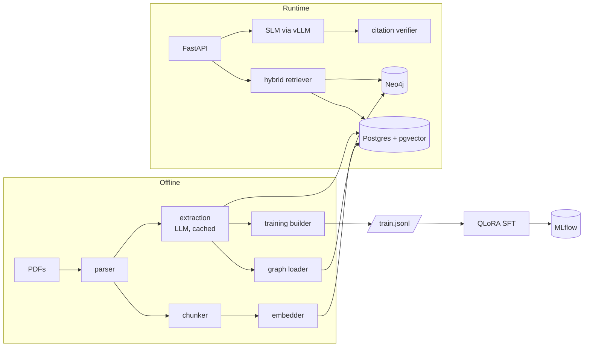
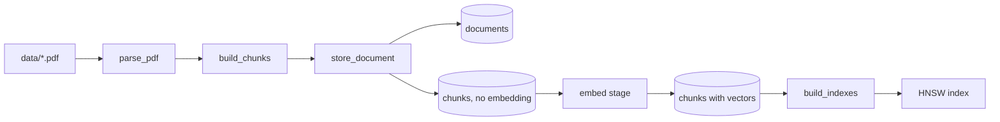
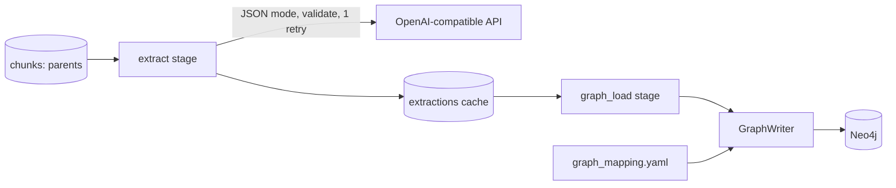
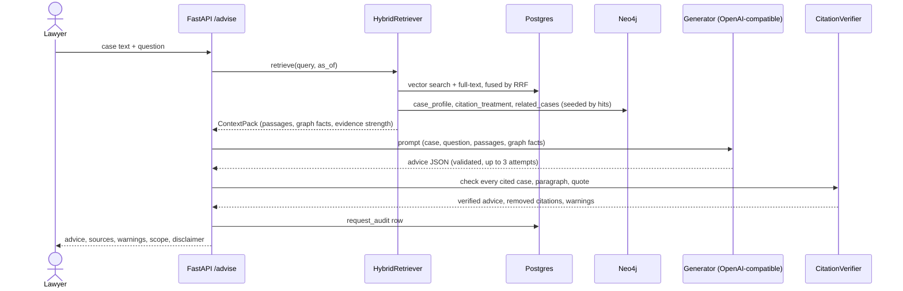
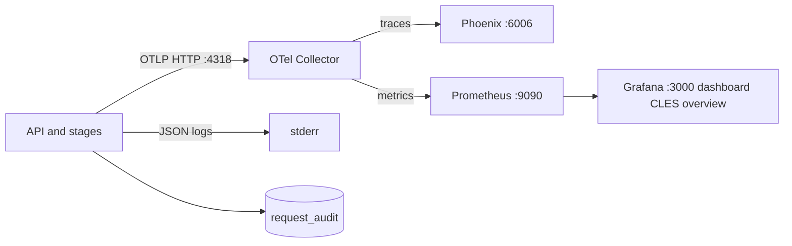
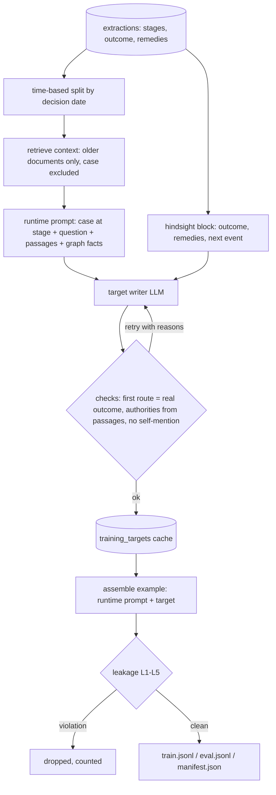
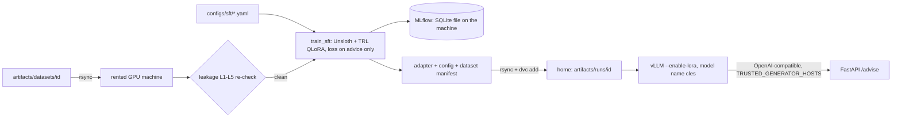

# 03. Architecture

Authoritative detail is in `INSTRUCTIONS.md`; this page is the working overview and is updated with the code.

## Components

## Modules (`src/cles/`)

| Module | Role | Status |
|--------|------|--------|
| `config.py` | `Settings`, the only reader of the environment | done |
| `observability/logging.py` | JSON logs with `request_id`, `redact()` | done |
| `stage.py` | Stage contract: args, JSON summary, exit code | done |
| `cli.py` | `cles run <stage...>` thin runner | done |
| `domain/pack.py`, `domain/check.py` | Pack loader and validator; `validate_pack` stage | done |
| `ingestion/parser.py` | PDF text to `ParsedDocument` (paragraphs, sections, metadata) using the pack's `sections.yaml` | done |
| `ingestion/chunker.py` | Parent (section) and child (at most 400 tokens) chunks with deterministic ids | done |
| `ingestion/store.py`, `ingest.py` | Idempotent write of documents and chunks; `ingest` stage with quarantine | done |
| `ingestion/embedder.py`, `embed.py` | bge-base embeddings (`cpu`/`cuda`/`auto`); `embed` stage, resumable | done |
| `ingestion/indexes.py`, `build_indexes.py` | HNSW index create/drop; `build_indexes` stage | done |
| `db.py` | Connection and `recorded_run` (writes `ingestion_runs`) | done |
| `llm/` | `LLMClient` protocol, OpenAI-compatible client, cost estimate | done |
| `extraction/extractor.py`, `extract.py` | Prompt, JSON validation, one retry; `extract` stage with cache, threads, dry-run estimate | done |
| `graph/client.py`, `writer.py`, `load.py` | Constraints from the pack; generic mapping-driven writer; `graph_load` stage | done |
| `retrieval/` | `search` (pgvector, full-text), `fusion` (RRF), `graph` (Cypher templates), `rerank` (optional), `hybrid` (`HybridRetriever`, evidence strength) | done |
| `inference/` | `prompt`, `advisor`, `verifier`, `guard`, `app` (FastAPI) | done |
| `evaluation/` | `retrieval` metrics, `run` (`evaluate` stage, optional generation) | done |
| `observability/telemetry.py`, `metrics.py` | OpenTelemetry setup, spans, metrics | done |
| `manifest.py` | `record_manifest` stage (`build_manifest` row) | done |
| `training/` | `dataset` (split, questions, hindsight), `target` (generate and check targets), `leakage` (L1-L5), `build_dataset` and `check_dataset` stages | done |
| `inference/calibration.py` | Caps route likelihood by evidence strength (runtime and training) | done |
| `training/` | Phases 4 and 5 | planned |

## Infrastructure (`infra/`)

- `docker-compose.yml`: `postgres` (pgvector pg16), `flyway` (one-shot migrations), `neo4j` 5.26, `mlflow` (profile `training`).
- Migrations: `infra/postgres/migrations/V<n>__*.sql`. `infra/postgres/init/` only creates the `mlflow` database (runs on first start of an empty volume).
- Compose reads secrets from `.env` and fails if a password is missing.

## Domain pack

`domain_packs/<name>/` holds the graph schema, prompts, JSON schemas, outcomes, section hints and Cypher templates. `load_pack()` validates:

- all required files exist
- relationship endpoints reference declared node labels
- both JSON schemas are valid
- outcomes and remedies are unique
- every Cypher template uses only declared labels and relationships and filters on `$as_of`

## Stage contract

Each stage is `python -m cles.<module>` with `--limit`, `--dry-run`, `--run-id`; it logs to stderr, prints one JSON summary line to stdout and exits non-zero on failure. Stages are registered in `cli.STAGES`.

## Ingestion (Phase 1)

Commands: `cles run ingest embed build_indexes` (all accept `--limit`, `--dry-run`).

- `doc_id` is the file name (`2026_ONCA_719.pdf` becomes `2026 ONCA 719`); the citation line inside the PDF is unreliable (footnote digits get glued on).
- Re-running `ingest` skips unchanged files (`content_hash`), replaces a changed file, and reports a file with identical content under another name as a duplicate.
- A PDF that fails to parse is quarantined: listed in the stage summary and `ingestion_runs.stats`, and the run continues.
- `embed` drops the HNSW index when more than 1000 chunks are pending; `build_indexes` recreates it.
- Chunk sizes use a cheap token estimate (about 1.3 per word); the embedder truncates at 512 tokens.
- Known gaps: footnotes stay inside paragraph text; only all-caps headings are detected; scanned PDFs are rejected (no OCR yet).

## Extraction and graph (Phase 2)

Commands: `cles run extract graph_load` (`--dry-run` on `extract` prints token and cost estimates).

- Needs `LLM_MODEL` and `OPENAI_API_KEY` in `.env` for a real run; set `LLM_PRICE_*` to get cost figures.
- Cache key `(doc_id, schema_version, model)`; `schema_version` = pack version + hash of prompt and schema. `invalid` and `failed` rows are retried on the next run.
- `graph_load` takes the newest `ok` extraction per document for the current `schema_version`.
- `graph_mapping.yaml` (per pack) maps extraction fields to nodes and relationships; the loader validates it against `graph_schema.yaml`.
- Re-writing a document replaces its relationships. Cited cases outside the corpus are stubs (`in_corpus = false`).
- Known gaps: no entity resolution (name variants are separate nodes); no `Statute` nodes yet (`PART_OF` unmapped); no batch API.
- Identity fields come from the parser, not the model: `known_fields` in `pack.yaml` (case id, title, date) are passed to the model as known facts and override its output. `tidy` drops nulls and matches enum values case-insensitively before validation.
- Local models: any OpenAI-compatible endpoint works, for example Ollama (`LLM_BASE_URL=http://localhost:11434/v1`, `OPENAI_API_KEY=ollama`, `LLM_MODEL=<name>`). Ollama's default context is small; use a model variant with `num_ctx 16384` or more. 1B-class models (qwen2.5:1.5b, gemma3:1b) reached only 5 and 3 valid results out of 15 and were semantically weak, so they are only useful for testing the pipeline.
- Leakage guard in extraction: the pack's `leak_check` (regexes on each stage's `known_so_far`) rejects text that describes the Court of Appeal's own decision; the reason is sent back to the model in the retry, and a second failure stores the row as `invalid`. Prompt v1 defines the four stages as cumulative and forbids hindsight.
- Outcome facets: `outcome` is the disposition (one value); `remedies` is a list. A schema rule rejects remedies on a dismissed appeal. Graph: `Case-[:RESULTED_IN]->Outcome`, `Case-[:ORDERED]->Remedy`.

## Runtime (Phase 3)

Run: `uv run uvicorn cles.inference.app:create_app --factory --port 8000`, then `POST /advise` with `case_text`, `question` (optional `as_of` for evaluation). The app refuses to start if `LLM_BASE_URL` is external and `ALLOW_EXTERNAL_GENERATOR` is not `true`; use public or synthetic cases only in that mode. Design decisions: ADR 0013.

## Observability (Phase 3)

Start: set `GRAFANA_PASSWORD` in `.env`, then `docker compose --env-file .env -f infra/docker-compose.yml --profile observability up -d`; set `TELEMETRY_ENABLED=true`. Metrics: `cles_advise_duration_milliseconds`, `cles_answers_total{evidence}`, `cles_citations_total{result}`, `cles_llm_tokens_total{direction}`, `cles_stage_runs_total{stage,status}`. Spans carry counts and timings; question text is redacted unless `TELEMETRY_CAPTURE_CONTENT=full`.

## Evaluation (Phase 3)

`cles run evaluate` runs `eval/retrieval_dev.yaml` (15 hand-written questions, one expected decision each) and writes `artifacts/eval/<run_id>.json` with recall@1/3/5 and MRR. `python -m cles.evaluation.run --with-generation` also calls the generator and reports citation pass rate, weak-evidence share and latency (paid, public or synthetic questions only). With 15 distinct decisions the retrieval numbers are a plumbing check, not a quality measure.

## Training data (Phase 4)

Commands: `cles run build_dataset` (`--dry-run` retrieves and estimates cost; `--limit N`), then `cles run check_dataset`. Output in `artifacts/datasets/<run id>/`. Each line has `messages` (system, user, assistant) plus metadata (`doc_id`, `stage`, `as_of`, `split`, `context_docs`, `outcome`, `remedies`, `evidence_strength`). Settings: `TRAINING_EVAL_FRACTION` (default 0.1), `TRAINING_OUT_DIR`. The pack supplies `training.yaml` (questions per stage) and `target_prompt.md`. Design: ADR 0014.

Cached targets are re-checked on every build with the current rules, so tightening a rule regenerates only the affected examples. The dataset folder is tracked with DVC (`artifacts/datasets.dvc`).

Stage-aware advice (ADR 0015): the advice JSON has a `stage` and each route a `next_event`; `expected_outcome` is optional before a decision exists and required afterwards. Likelihood is capped by evidence and by stage (`likelihood_caps_by_stage` in `pack.yaml`). At early stages the dataset builder rejects first-route names that read as an appeal result (`early_route_name_patterns` in `training.yaml`).

## Fine-tuning and serving (Phase 5)

Stage `train_sft` (`--dry-run`: leakage re-check, token statistics, template preview, time and cost estimate when `estimate:` is set in the config). Config: `configs/sft/qwen3_8b_qlora.yaml`; `plain` backend and `smoke_cpu.yaml` for pipeline smoke tests. Lineage tags on every MLflow run: git commit, DVC hashes, dataset hashes, pack version, base model. Serving profile `serve` (vLLM v0.33.0). Steps and budget: `docs/06-training-runbook.md`. Design: ADR 0016.
