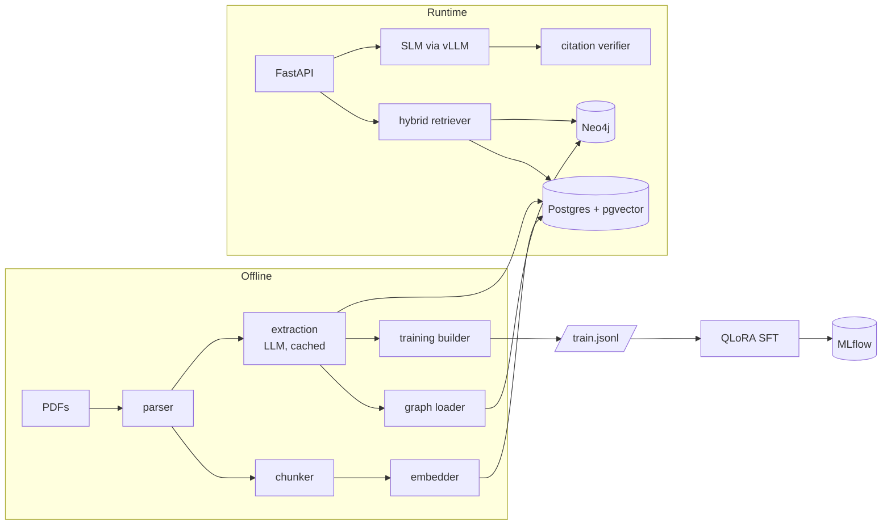

# 03. Architecture

Authoritative detail is in `INSTRUCTIONS.md`; this page is the working overview and is updated with the code.

## Components

## Modules (`src/cles/`)

| Module | Role | Status |
|--------|------|--------|
| `config.py` | `Settings`, the only reader of the environment | done |
| `observability/logging.py` | JSON logs with `request_id`, `redact()` | done |
| `stage.py` | Stage contract: args, JSON summary, exit code | done |
| `cli.py` | `cles run <stage...>` thin runner | done |
| `domain/pack.py`, `domain/check.py` | Pack loader and validator; `validate_pack` stage | done |
| `ingestion/`, `extraction/`, `graph/` | Phases 1 and 2 | planned |
| `retrieval/`, `inference/`, `evaluation/` | Phase 3 | planned |
| `training/` | Phases 4 and 5 | planned |

## Infrastructure (`infra/`)

- `docker-compose.yml`: `postgres` (pgvector pg16), `flyway` (one-shot migrations), `neo4j` 5.26, `mlflow` (profile `training`).
- Migrations: `infra/postgres/migrations/V<n>__*.sql`. `infra/postgres/init/` only creates the `mlflow` database (runs on first start of an empty volume).
- Compose reads secrets from `.env` and fails if a password is missing.

## Domain pack

`domain_packs/<name>/` holds the graph schema, prompts, JSON schemas, outcomes, section hints and Cypher templates. `load_pack()` validates:

- all required files exist
- relationship endpoints reference declared node labels
- both JSON schemas are valid
- outcomes are unique
- every Cypher template uses only declared labels and relationships and filters on `$as_of`

## Stage contract

Each stage is `python -m cles.<module>` with `--limit`, `--dry-run`, `--run-id`; it logs to stderr, prints one JSON summary line to stdout and exits non-zero on failure. Stages are registered in `cli.STAGES`.
