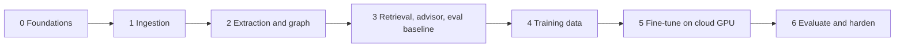

# 04. Implementation plan

Each phase ends with a user confirmation. The system is testable after Phase 3, before any GPU spend. Full task lists are in `INSTRUCTIONS.md` section 15.

## Phase 0: Foundations

| Task | Status |
|------|--------|
| docs 01 to 05 and ADRs | done |
| `pyproject.toml`, `.env.example`, `.gitignore`, `Settings` | done |
| Compose: postgres, flyway, neo4j, mlflow (profile); baseline migration | done, verified |
| Stage contract and `cles run` | done |
| Domain pack loader and `legal_ca_on` skeleton | done |
| JSON logging, `redact()` | done |
| DVC initialised with local remote (`~/dvc-store/cles`), `data/` tracked | done |
| `build_manifest` table | done (in V1) |

## Phase 1: Ingestion

| Task | Status |
|------|--------|
| Parser with tests on the 15 sample PDFs | done |
| Chunker (parent/child) and tests | done |
| Idempotent Postgres ingestion with quarantine | done |
| Embedder and resumable `embed` stage | done |
| `build_indexes` stage | done |
| Validate the parser on a larger random sample of real files | waiting for the user's files |

## Phase 2: Extraction and graph

| Task | Status |
|------|--------|
| LLM provider interface, cache, cost estimate, dry run | done |
| Extraction prompt (v1) and schema for the legal pack | done; run on 15 samples with gpt-5.4-mini |
| Generic graph writer, constraints, mapping | done, tested with a hand-written fixture |
| Run extraction on the 15 samples and iterate the prompt | done: 15/15 valid, about $0.22 |
| Load the sample graph from real extractions | done: 118 Case nodes (15 in corpus), 106 citations |
| Split outcome into disposition and remedy | done (ADR 0012), re-extracted on 15 samples |

## Phase 3: Retrieval, advisor, evaluation baseline

| Task | Status |
|------|--------|
| Vector + full-text search, RRF, `as_of` and self-exclusion | done |
| Cypher templates seeded by passage hits (profile, citations, related cases) | done |
| Optional reranker | done, no real model tried |
| LLM query analysis | deferred (ADR 0013) |
| Citation verifier | done |
| FastAPI service with generator guard and `request_audit` | done, tested with a fake generator |
| Run the API with a real model on a public sample question | done: gpt-5.4-mini, 14 s, 9 citations all verified |
| Evaluation harness (retrieval metrics, optional generation metrics) | done; generation metrics not yet run |
| OpenTelemetry, Phoenix, Prometheus, Grafana (profile `observability`) | done, verified |
| `record_manifest` stage | done |

## Phase 4: Training data

| Task | Status |
|------|--------|
| Time-based split (newest documents = evaluation) | done |
| Stage-cut examples with runtime-identical prompts | done |
| Target writer with checks, retries, likelihood cap, cache (`training_targets`, Flyway V3) | done, tested with a fake LLM |
| Leakage rules L1-L5 as code, plus independent `check_dataset` stage | done |
| Run on the 15 samples (59 examples) | waiting for the user's approval (paid; about $0.9 estimated) |
| Add the dataset to DVC | after the first real build |

## Later phases

See `INSTRUCTIONS.md` section 15.
