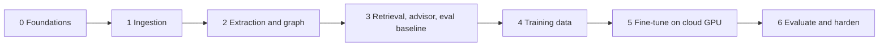

# 04. Implementation plan

Each phase ends with a user confirmation. The system is testable after Phase 3, before any GPU spend. Full task lists are in `INSTRUCTIONS.md` section 15.

## Phase 0: Foundations

| Task | Status |
|------|--------|
| docs 01 to 05 and ADRs | done |
| `pyproject.toml`, `.env.example`, `.gitignore`, `Settings` | done |
| Compose: postgres, flyway, neo4j, mlflow (profile); baseline migration | done, verified |
| Stage contract and `cles run` | done |
| Domain pack loader and `legal_ca_on` skeleton | done |
| JSON logging, `redact()` | done |
| DVC initialised with local remote (`~/dvc-store/cles`), `data/` tracked | done |
| `build_manifest` table | done (in V1) |

## Phase 1: Ingestion

| Task | Status |
|------|--------|
| Parser with tests on the 15 sample PDFs | done |
| Chunker (parent/child) and tests | done |
| Idempotent Postgres ingestion with quarantine | done |
| Embedder and resumable `embed` stage | done |
| `build_indexes` stage | done |
| Validate the parser on a larger random sample of real files | waiting for the user's files |

## Later phases

See `INSTRUCTIONS.md` section 15.
