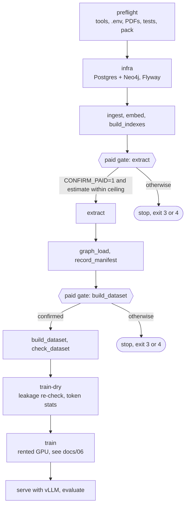

# 07. Run playbook

How to run the whole pipeline, by hand or from a scheduler. One driver, `scripts/pipeline.sh`, calls the stages through `cles run`, so anything that can run a shell command can run the pipeline [pl.2].

## Flow

The steps up to `train-dry` run on the laptop. `train` needs a GPU machine and is not part of `all`.

## Steps

| Step | What it runs | Paid | Notes |
|------|--------------|------|-------|
| `preflight` | tool and `.env` checks, PDF count, `pytest`, `validate_pack` | no | `SKIP_TESTS=1` skips pytest |
| `infra` | whole stack: Postgres, Neo4j, MLflow, Collector, Phoenix, Prometheus, Grafana; waits for healthy | no | Flyway migrates the schema first; turns telemetry on |
| `data` | `ingest embed build_indexes extract graph_load record_manifest` | `extract` | gate before `extract` |
| `dataset` | `build_dataset check_dataset` | `build_dataset` | gate before the build |
| `train-dry` | `train_sft --dry-run` | no | leakage re-check, token statistics, template preview |
| `train` | `train_sft` | no (GPU time) | run on the GPU machine |
| `eval` | `eval_generate` (OpenAI baseline), `eval_score` | yes | gate before generation; public decisions only |
| `eval-score` | `eval_score` | no | scores every system found in `artifacts/eval/*/outputs.jsonl` |
| `judge` | `judge_eval`, `eval_score`, `judge_calibrate` | yes | public decisions only; about $1 to 2 for 144 answers |
| `drift` | `drift_check` | no | exit 5 when violations are found (eval vs baseline, live traffic vs reference) |
| `snapshot` | `dvc add` + `dvc push` | no | exports, datasets, eval outputs, adapters; runs automatically after the data steps |
| `alerts-test` | `promtool test rules` | no | unit tests of the Prometheus alert rules |
| `mlflow-import` | `cles.mlflow_import` | no | `--source sqlite:///file.db`: copy a GPU machine's runs into the server and register adapters |
| `console` | web console on port 8000 | no | home page, explorer, platform tools, about; needs `infra` for the tool links |
| `explore` | results explorer web page | no | reads `artifacts/eval/` only; port `EXPLORER_PORT` (8001) |
| `all` | `preflight infra data dataset train-dry` | yes | |
| `status` | row counts, latest runs, datasets | no | |
| `reset` | drops Postgres and Neo4j volumes | no | `CONFIRM_RESET=1`; also deletes the paid caches |

## Paid gate

`extract` and `build_dataset` first run with `--dry-run` and print an estimate. They continue only if `CONFIRM_PAID=1` and the estimate is at most `MAX_COST_USD` (default 10). Prices come from `LLM_PRICE_INPUT_PER_MTOK` and `LLM_PRICE_OUTPUT_PER_MTOK` (script defaults 0.75 and 4.50, unverified: check the provider page). Real cost is usually different (hidden reasoning tokens raise it; the estimate also ignores the cache). Every call is cached, so a rerun does not pay twice.

## Settings

| Variable | Default | Meaning |
|----------|---------|---------|
| `PIPELINE_DATA_DIR` | `data/criminal_and_civil` | PDF folder; overrides `DATA_DIR` from `.env` (ingest is not recursive) |
| `CONFIRM_PAID` | unset | `1` allows paid LLM calls |
| `MAX_COST_USD` | 10 | ceiling for one paid step's estimate |
| `PIPELINE_LOG_DIR` | `artifacts/pipeline` | logs go to `<dir>/<timestamp>/` |
| `SKIP_TESTS` | unset | `1` skips pytest in `preflight` |

## Exit codes and logs

| Code | Meaning |
|------|---------|
| 0 | ok |
| 1 | a stage failed |
| 2 | bad usage, missing tool, `.env` value or PDFs |
| 3 | paid step not confirmed (or reset not confirmed) |
| 4 | estimate above `MAX_COST_USD` |

Each run writes `artifacts/pipeline/<timestamp>/`: `<stage>.log` (stdout), `<stage>.log.err` (stderr) and `summary.jsonl` (one JSON summary line per stage, from the stage contract). A scheduler only needs the exit code and `summary.jsonl`.

## Hooking it to a scheduler

- **cron or CI job:** `CONFIRM_PAID=1 MAX_COST_USD=5 scripts/pipeline.sh all`; alert on a non-zero exit.
- **Staged approval:** run without `CONFIRM_PAID`; exit 3 means "estimate printed, waiting for a human". Rerun with `CONFIRM_PAID=1` after review.
- **flowlit or another orchestrator:** one task per step (`preflight`, `infra`, `data`, `dataset`, `train-dry`), or call the stages directly: `python -m cles.<module> --run-id ...` (ADR 0005).
- **GPU training:** a separate job on the GPU machine: `scripts/pipeline.sh train` after copying the dataset (docs/06).

## Rerun on new data

1. Put the PDFs in a folder (not nested) and set `PIPELINE_DATA_DIR`.
2. `scripts/pipeline.sh data`. Ingest skips files it has seen (by hash); extraction skips decisions it has extracted with the same schema version and model.
3. `scripts/pipeline.sh dataset` writes a new dataset folder; the split date moves with the data.
4. For a clean start (different corpus, no old documents): `CONFIRM_RESET=1 scripts/pipeline.sh reset`, then `infra` and the rest.

## Model evaluation

1. `CONFIRM_PAID=1 scripts/pipeline.sh eval`: the OpenAI baseline on the held-out examples (about $0.5 to 1), then the score.
2. On the GPU machine, for each local system: `scripts/gpu_setup.sh eval base` and `scripts/gpu_setup.sh eval finetuned`, each followed by `scripts/gpu_setup.sh wait eval-<system>` (about 10 to 20 minutes each). Copy `artifacts/eval/<system>/outputs.jsonl` back.
3. `scripts/pipeline.sh eval-score` rebuilds `artifacts/eval/report.md` and `report.json`. Systems are defined in `eval/systems.yaml`.
4. `scripts/pipeline.sh explore` opens the results explorer (side-by-side answers and statistics) on port 8001.

## Where to look

| Tool | URL | What it shows |
|------|-----|---------------|
| MLflow | http://localhost:5000 | one run per stage run (`cles-pipeline`), per evaluated system (`cles-eval`), training runs (`cles-sft`), model registry `cles-advisor`; compare runs side by side |
| Grafana | http://localhost:3000 | `CLES model quality and pipeline` (scores per system, progress per evaluation, cost), `CLES overview` (runtime) |
| Phoenix | http://127.0.0.1:6006 | traces of stages and requests (internal use only, ADR 0007) |
| Prometheus | http://localhost:9090/alerts | alert rules and their state |
| Console | http://localhost:8000 | one landing page with all of the below |
| Explorer | http://localhost:8001 | answers of all systems side by side, your labels (blind mode), judge scores |
| DVC | `dvc metrics diff <rev>` | evaluation scores between commits |

After a GPU session: copy `artifacts/mlflow.db` back as `artifacts/mlflow-gpu.db`, then `scripts/pipeline.sh mlflow-import --source sqlite:///artifacts/mlflow-gpu.db`.

## Duration notes (laptop, 105 decisions)

`embed` on CPU about 10 min; `extract` about 4 min; `dataset` about 30 min (the dry-run estimate alone takes over 2 min). Run long steps in the background (`setsid nohup scripts/pipeline.sh dataset > out.log &`) and follow `artifacts/pipeline/<timestamp>/summary.jsonl`.

## Proof-of-concept run (goal 1)

The PoC uses about 100 decisions [pr.1]. Expected cost is about $15 to 35 in total; measured API cost was about $8.75 (see docs/06). Cost-saving options: fewer stages per decision, the provider batch API, a smaller base model, and stopping the GPU machine right after each step.
