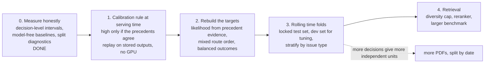

# Improvement plan: measure honestly, then calibrate (in progress)

Status: direction agreed 2026-11-16. Steps 0, 1 and 3 are built (ADR 0023); step 2 is built except for generating targets and training (ADR 0024); step 4 is planned. Reasoning and numbers: `.agent/memory/refs/ml.9.md` [ml.9]; split and measurement design: ADR 0022.

## Problem

The fine-tuned model has the structure right (schema 100%, stage 100%, 3-4% failed citations) but is overconfident: a top route rated "high" is right about half the time (47% at 4-bit, 50% at 16-bit; gate 67%), and its top-route accuracy (46-50%) is no better than a plain vote among the retrieved decisions' outcomes (58%). Acceptance stays "rejected (provisional)" (docs/05, ADR 0021).

Two causes, found in the data (ADR 0022):
- Training targets: the first route always equals the real outcome and 143 of the 359 (40%) are rated "high", so the model learns to lead with a confident route it cannot know at inference.
- Heterogeneous data and a small evaluation: legal cases do not repeat, the 48 evaluation examples are 12 decisions, and the outcome mix differs between training (79% dismissed) and evaluation (42%). Differences between systems are not measurable yet.

## Goal

"High" must mean something, or be shown rarely. Higher outcome accuracy is not the goal: with 93 training decisions a fine-tune is not expected to beat precedent retrieval at outcome prediction. Every step is a separate MLflow experiment, scored with the same `eval_score` and `accept_check` (ADR 0019).

## Steps

| # | Step | Cost | Check |
|---|------|------|-------|
| 0 | Done 2026-11-16: cluster-bootstrap intervals over decisions, `baseline_prior` and `baseline_precedent` next to the systems, tracked criterion `outcome_vs_precedent`, `check_dataset` warnings (outcome shift, case families across the split). | none | `eval_score`, `check_dataset`, `tests/test_eval_statistics.py` |
| 1 | Replayed 2026-11-16 (docs/05): the rule makes "high" rarer (17 -> 7 for the fine-tune) and removes most wrong "high" routes (9 -> 3), precision 47% -> 57% (4 of 7), still under 67% and within noise at 12 decisions. Applied in the advisor from 2026-11-16 (switch `PRECEDENT_RULE_ENABLED`). Original design: a rule in `cap_likelihood`: a top route is "high" only if the evidence is strong and the retrieved similar decisions agree on that outcome (the precedent vote is right 5 of 8 times when they agree, against 47-50% for the model's own "high"); otherwise "medium". Replay it on the stored answers of every system. Derive the rule from the principle, not by fitting the 48 answers. | none | `high_precision` and its decision interval, share of answers still "high" |
| 2 | Built 2026-11-17 (ADR 0024), targets not yet generated (paid, needs approval): the retrieved precedents set the likelihood and the order of the routes (code decides, the model explains); the prompt states the precedent outcomes; the real path is one route among others, no longer always first. Free check on the dev folds: the precedent plurality as the top route, "high" only for unanimous precedents of at least two, was right 86% when rated high (22 examples, 18 decisions, interval 68 to 100), 57% medium. Original text: In the training targets: compute the likelihood from the outcomes of the retrieved decisions (code decides the number, the model explains the route); order or shuffle routes so the real outcome is not always first; weight or balance outcomes so the model does not learn the 79% base rate as skill. Regenerate, retrain, compare. | about 7.50 USD + about 1 USD GPU | acceptance gates, wrong-"high" count, `outcome_vs_precedent` |
| 3 | Built 2026-11-16 (ADR 0023, `pipeline.sh folds`): rolling time folds (train up to a date, evaluate on the next window, slide forward), group-aware, a locked test set touched once and a dev set for tuning rules; stratify and report by issue type (the extraction has free-text issues; a coarse taxonomy in the pack). Each fold retrains the adapter (about 1 USD GPU). | LLM calls for targets of new folds | intervals across folds; no result is tuned on the test set |
| 4 | Retrieval: per-decision diversity cap and a reranker, for citations that verify but do not fit the question (seen in the 2026-11-15 console test); a retrieval benchmark larger than the current 15 questions. | small | recall@k, MRR, citation relevance |

More decisions (PDFs) raise the number of independent units and help measurement most; they must be split by date so the evaluation stays newer than training. Diversity (courts, years, issue types) matters more than count.

## Case type (user question, 2026-11-16)

`case_type` (criminal or civil) is extracted and stored on each case in the graph but nothing else uses it. Dismissal rates are almost equal (68% criminal, 66% civil) but the remedies differ (criminal: sentence reduced, new trial, acquittal set aside; civil: order set aside, remitted, order varied). The corpus is now 45% civil, against 13% in the first training set. Experiments, each tracked in MLflow and measured on the dev folds:
- a. Report every metric per case type (built into `folds_report`), and keep both types in every fold.
- b. Same-type precedent vote (`baseline_precedent_same_type`, built; free) to see whether the type matters for the evidence.
- c. Case type as an explicit input in the prompt and training examples (the lawyer knows it before the decision, so it is no leakage; `case_type` is already written to every example), compared with and without.
- d. Same-type retrieval preference and a precedent rule that counts same-type decisions only.
One model with the type as input, not one model per type (185 criminal and 152 civil decisions are too few to split).

## Risks

- No step is guaranteed to reach the 67% gate. If step 1 alone does not, record that the model needs the serving-time calibration and keep it.
- A rule tuned on 48 answers overfits them; validate on decisions it has not seen (step 3).
- Changing targets (step 2) changes the dataset hash and needs the leakage tests and `check_dataset` again.
- Family detection warns, it does not prove independence (shared initials name different people; companions without a shared name are missed).

## Other open items

Fine-tuned-without-retrieval baseline (needs a GPU), calibrated judge (needs a lawyer; not possible in the PoC), Alertmanager receiver.
