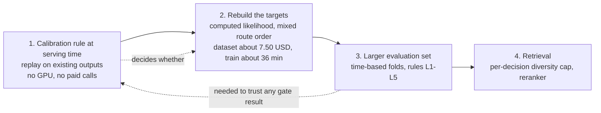

# Improvement plan: calibration first (planned, not started)

Status: agreed as a direction on 2026-11-16, no step started. Reasoning and numbers: `.agent/memory/refs/ml.9.md` [ml.9].

## Problem

The fine-tuned model has the structure right (schema 100%, stage 100%, 3-4% failed citations) but is overconfident: a top route rated "high" is right about half the time (47% at 4-bit, 50% at 16-bit; gate 67%), and top-route accuracy (46-50%) is not clearly better than the majority class (42%) or the base model with retrieval. Acceptance stays "rejected (provisional)" (docs/05, ADR 0021).

Likely cause: in the 359 training targets the first route always equals the real outcome and 143 of them (40%) are rated "high". The model learns to lead with a confident route it cannot know at inference time.

## Goal

"High" must mean something, or be shown rarely. Higher outcome accuracy is not the goal: with 359 examples and a 24-example late-stage evaluation (about +-20 points) a fine-tune is not expected to beat precedent retrieval at outcome prediction.

## Steps

Each step is a separate MLflow experiment, scored with the same `eval_score` and `accept_check`, so progress is comparable (ADR 0019).

| # | Step | Cost | Check |
|---|------|------|-------|
| 1 | A rule in `cap_likelihood`: a top route is "high" only if the evidence is strong and the retrieved similar decisions mostly share that outcome; otherwise "medium". Replay it on the 48 existing answers per system. Derive the rule from the principle, not by fitting the 48 answers. | none | `high_precision`, share of answers still rated "high" |
| 2 | In the training targets, compute the likelihood from the outcomes of the retrieved similar decisions (code decides the number, the model explains the route), and order or shuffle the routes so the real outcome is not always first. Regenerate the dataset, retrain, compare. | about 7.50 USD + about 1 USD GPU | acceptance gates, wrong-"high" count |
| 3 | More late-stage evaluation examples through time-based folds that keep the leakage rules. A 2/3 gate on 17 "high" answers is too noisy to separate a real gain from luck. | LLM calls for extra targets | interval width of `high_precision` |
| 4 | Retrieval: per-decision diversity cap and a reranker, for citations that verify but do not fit the question (seen in the 2026-11-15 console test). Needs a larger retrieval benchmark than the current 15 questions. | small | recall@k, MRR, citation relevance |

## Risks

- No step is guaranteed to reach the 67% gate. If step 1 alone does not, record that the model needs the serving-time calibration and keep it.
- A rule tuned on 48 answers overfits them; validate on examples it has not seen (step 3).
- Changing targets (step 2) changes the dataset hash and needs the leakage tests and `check_dataset` again.

## Other open items

Fine-tuned-without-retrieval baseline (needs a GPU), calibrated judge (needs a lawyer; not possible in the PoC), Alertmanager receiver.
